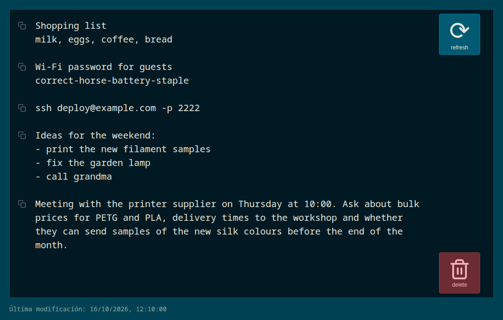

# Web Notepad

A web notepad in a single PHP file: open a URL, type, and it saves itself.
Fork of [pereorga/minimalist-web-notepad](https://github.com/pereorga/minimalist-web-notepad).



## What this fork adds

- **Safe saving across devices**: if the note changed on another device, it is not overwritten; the refresh button turns orange so you can load the server version.
- **Refresh and delete buttons** on the right side of the editor.
- **Dark theme** and a larger font.
- **Copy by block**: every block of text separated by a blank line gets an icon on the left that copies it to the clipboard.
- **Last modified date** below the editor.

## Installation

1. Copy the files to your server (PHP 7+).
2. Make the notes directory writable by the web server. It is `_tmp` by default; change it with `$save_path` at the top of `index.php` (preferably outside the document root).
3. Set up URL rewriting so that `/<note>` reaches `index.php?note=<note>`:

**Apache**: with `mod_rewrite` enabled and `AllowOverride` allowed, the included `.htaccess` is enough.

**Nginx** (project under `/notes/`):

```
location ~* ^/notes/([a-zA-Z0-9_-]+)$ {
    try_files $uri /notes/index.php?note=$1&$args;
}
```

## Command-line usage

```
# Read a note (curl and wget get plain text)
curl https://example.com/notes/test

# Save text or a file to a note
curl https://example.com/notes/test -d 'hello'
cat /etc/hosts | curl https://example.com/notes/hosts --data-binary @-
```

When reading with `?raw`, curl or wget, the response includes the `X-Note-Version` (content hash) and `X-Note-Mtime` (last modified, Unix timestamp) headers.

## License

Copyright 2012 Pere Orga <pere@orga.cat>. Changes in this fork are released under the same license.

Licensed under the [Apache License 2.0](http://www.apache.org/licenses/LICENSE-2.0).
