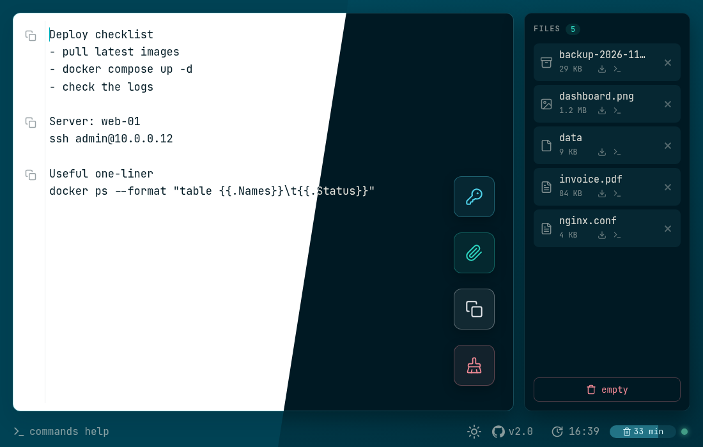
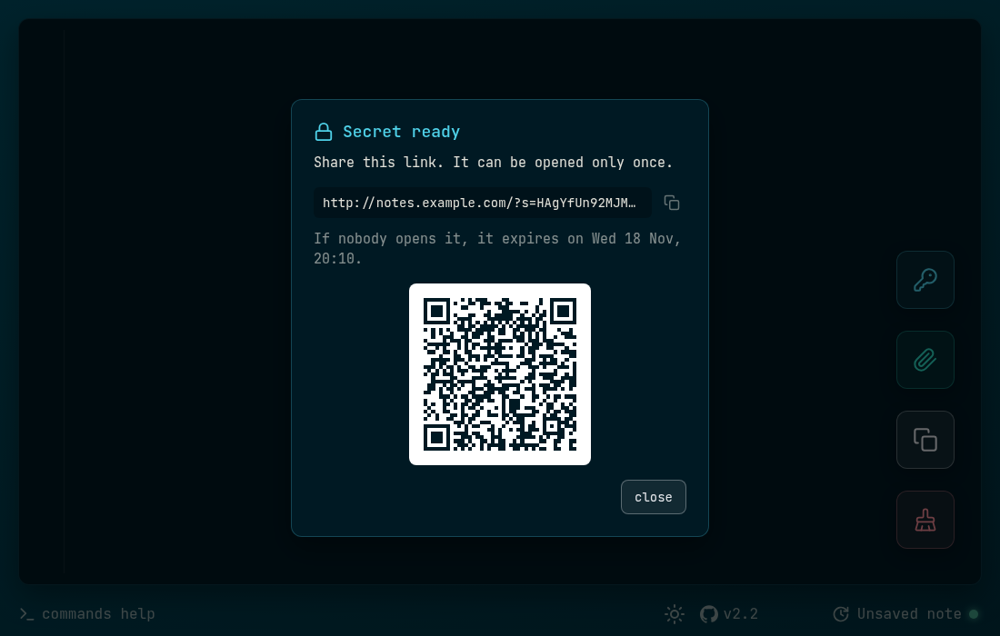
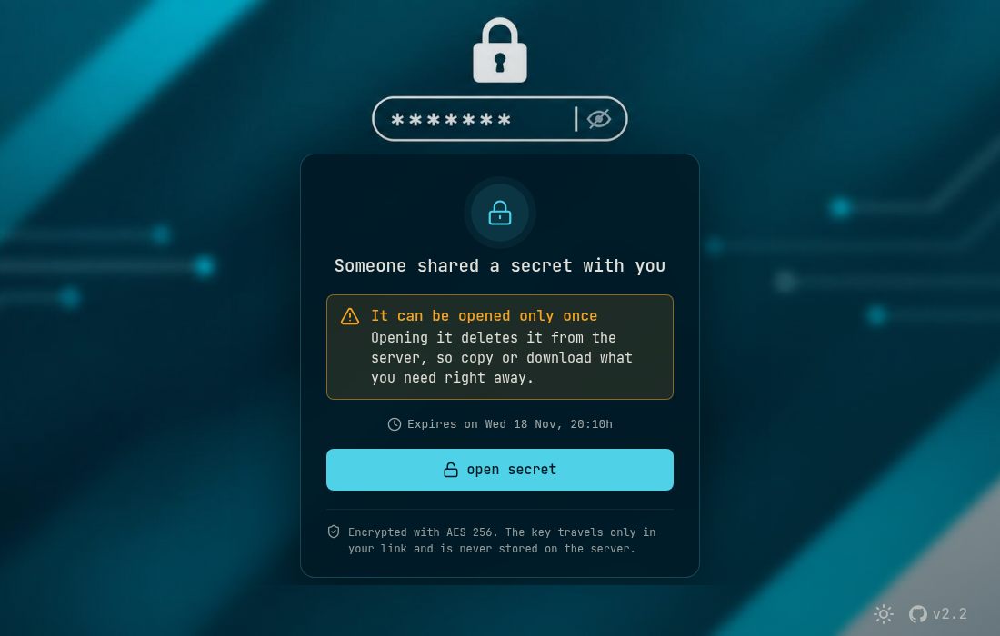

# Web Notepad

A web notepad in a single PHP file: open a URL, type, and it saves itself. Drop files on it to share them between devices.
Fork of [pereorga/minimalist-web-notepad](https://github.com/pereorga/minimalist-web-notepad).

## What this fork adds

- **Attachments**: drop files on the page or use the attach button to share them along with the note.
- **Live sync**: changes made on another device show up within a couple of seconds.
- **Safe saving**: editing on two devices at once never overwrites the note; you choose when to reload.
- **Save status**: a dot shows whether the note is saved, pending or in conflict.
- **Copy by block**: each paragraph has its own copy button; there is also a copy all button.
- **Secrets**: turn a note into an encrypted one-time link, with a QR code, that is deleted once opened.
- **Auto-delete**: notes not changed for a while are deleted; the footer shows the time left.
- **Command line**: read, write and attach files with `curl`; the footer shows the commands.
- **Light and dark themes**: follows the system, with a button to switch.
- **Docker and Kubernetes**: a hardened container image and ready-to-use manifests.

## Secrets

## License

Copyright 2012 Pere Orga <pere@orga.cat>. Changes in this fork are released under the same license.

Licensed under the [Apache License 2.0](http://www.apache.org/licenses/LICENSE-2.0).
