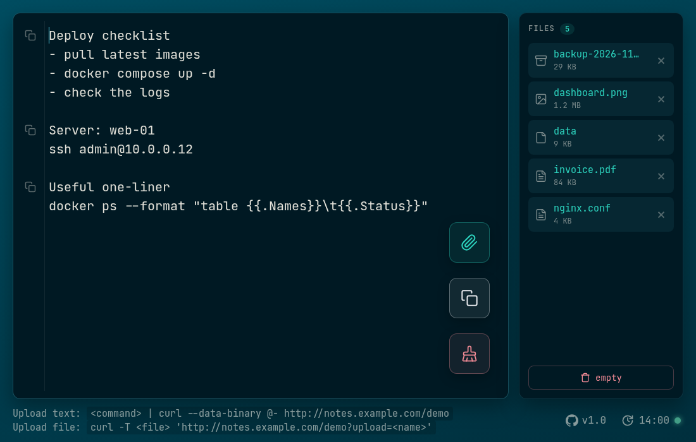

# Web Notepad

A web notepad in a single PHP file: open a URL, type, and it saves itself. Drop files on it to share them between devices.
Fork of [pereorga/minimalist-web-notepad](https://github.com/pereorga/minimalist-web-notepad).



## What this fork adds

- **File attachments**: drag files anywhere onto the page or use the **attach file** button (up to 5 MB each). The first file splits the screen and opens a **Files** panel on the right (below the editor on narrow screens) to download or delete each file, plus an **empty** button that deletes all of them and keeps the text.
- **Live sync across devices**: text and file changes made on another device (or uploaded with `curl`) show up within a couple of seconds, keeping your cursor in place. Polling pauses while the tab is hidden.
- **Safe saving across devices**: if you edit on two devices at the same time, the note is not overwritten; autosave pauses and an amber refresh button appears so you can load the server version.
- **Save status indicator**: a dot next to the time shows whether the note is saved (green), pending (amber) or in conflict (red).
- **Action buttons** on the right side of the editor (labels appear on hover):
  - **attach file**: picks files to upload (also works on mobile, where there is no drag and drop).
  - **copy all**: copies the whole note to the clipboard.
  - **clear**: empties the note (and deletes it on the server) without asking.
- **Copy by block**: every block of text separated by a blank line gets an icon on the left that copies it to the clipboard; hovering it highlights the block.
- **Footer** with ready-to-copy `curl` commands to upload text or a file to the current note, a link to this repository with the app version, and the last saved time.
- **Dark theme** and a larger font.

## Installation

1. Copy `index.php`, `.htaccess` and `favicon.ico` to your server (PHP 7+).
2. Make the notes directory writable by the web server. It is `/var/lib/notas` by default; change it with `$save_path` at the top of `index.php` (preferably outside the document root). Attachments are stored there too, in a `<note>.files/` directory per note.
3. Set up URL rewriting so that `/<note>` reaches `index.php?note=<note>`, keeping the query string:

**Apache**: with `mod_rewrite` enabled and `AllowOverride` allowed, the included `.htaccess` is enough.

**Nginx** (project under `/notes/`):

```
location ~* ^/notes/([a-zA-Z0-9_-]+)$ {
    try_files $uri /notes/index.php?note=$1&$args;
}
```

### Attachment settings

The limits are at the top of `index.php`: `$max_file_size` (5 MB per file) and `$max_total_size` (100 MB for all the attachments of all notes together).

Files are sent as the raw request body, so PHP's `file_uploads` can stay disabled. The web server and PHP must still accept request bodies a bit larger than `$max_file_size`:

- PHP: `post_max_size` (8 MB by default, enough for 5 MB files).
- Nginx: `client_max_body_size` (1 MB by default, so it must be raised).

### Security notes

- Attachments are only served through `index.php`, always as a download (`Content-Disposition: attachment`) with `X-Content-Type-Options: nosniff` and a sandboxing `Content-Security-Policy`, so an uploaded HTML or SVG file can never run scripts on your domain.
- File names are reduced to `[a-zA-Z0-9._-]`, so paths like `../../etc/passwd` end up as a plain file name inside the note's directory.
- There is no authentication: anyone who knows a note's URL can read it and upload files to it. Keep `$max_total_size` low and consider deleting notes periodically, e.g. with a daily cron job: `find /var/lib/notas -mindepth 1 -delete`.

## Command-line usage

```
# Read a note (curl and wget get plain text)
curl https://example.com/notes/test

# Save the output of a command to a note
ls -la | curl --data-binary @- https://example.com/notes/test

# Save a file's contents as the note text
curl --data-binary @/etc/hosts https://example.com/notes/hosts

# Attach a file to a note (the name after ?upload= is the stored name)
curl --upload-file report.pdf 'https://example.com/notes/test?upload=report.pdf'

# Download an attachment with its original name
curl --remote-name --remote-header-name 'https://example.com/notes/test?file=report.pdf'

# List the attachments of a note (JSON)
curl 'https://example.com/notes/test?files'
```

Use `--data-binary` rather than `--data`, which strips newlines. Saving text from the command line always overwrites the note, and sending an empty body deletes it. Uploading a file with the same name as an existing attachment replaces it.

When reading with `?raw`, curl or wget, the response includes the `X-Note-Version` (content hash) and `X-Note-Mtime` (last modified, Unix timestamp) headers.

## License

Copyright 2012 Pere Orga <pere@orga.cat>. Changes in this fork are released under the same license.

Licensed under the [Apache License 2.0](http://www.apache.org/licenses/LICENSE-2.0).
